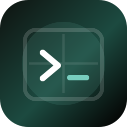
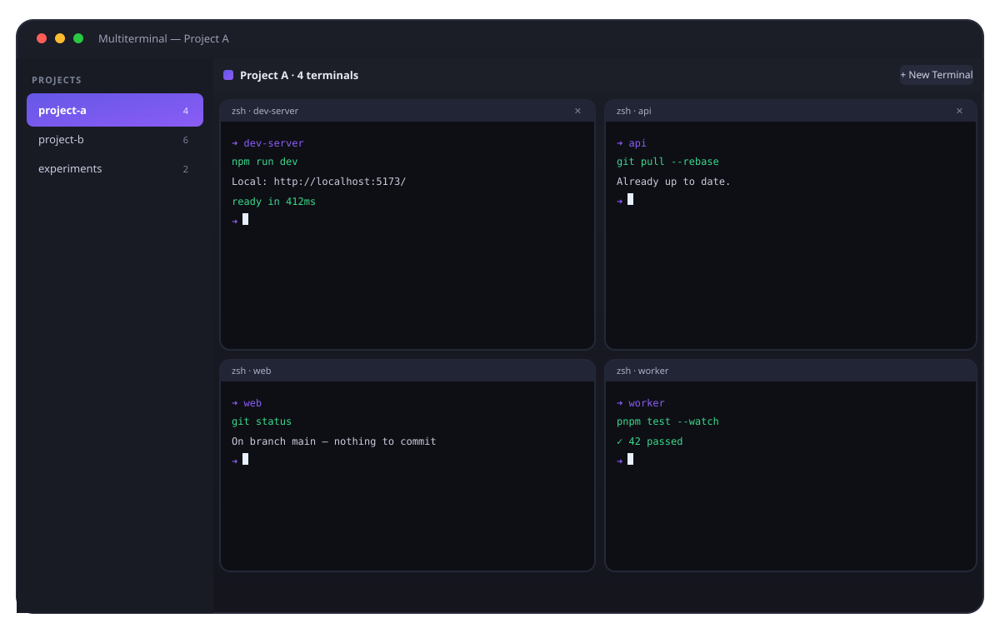
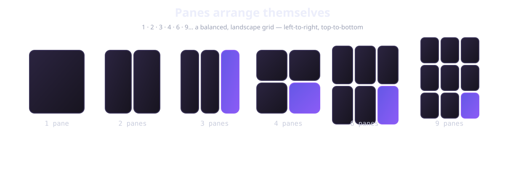
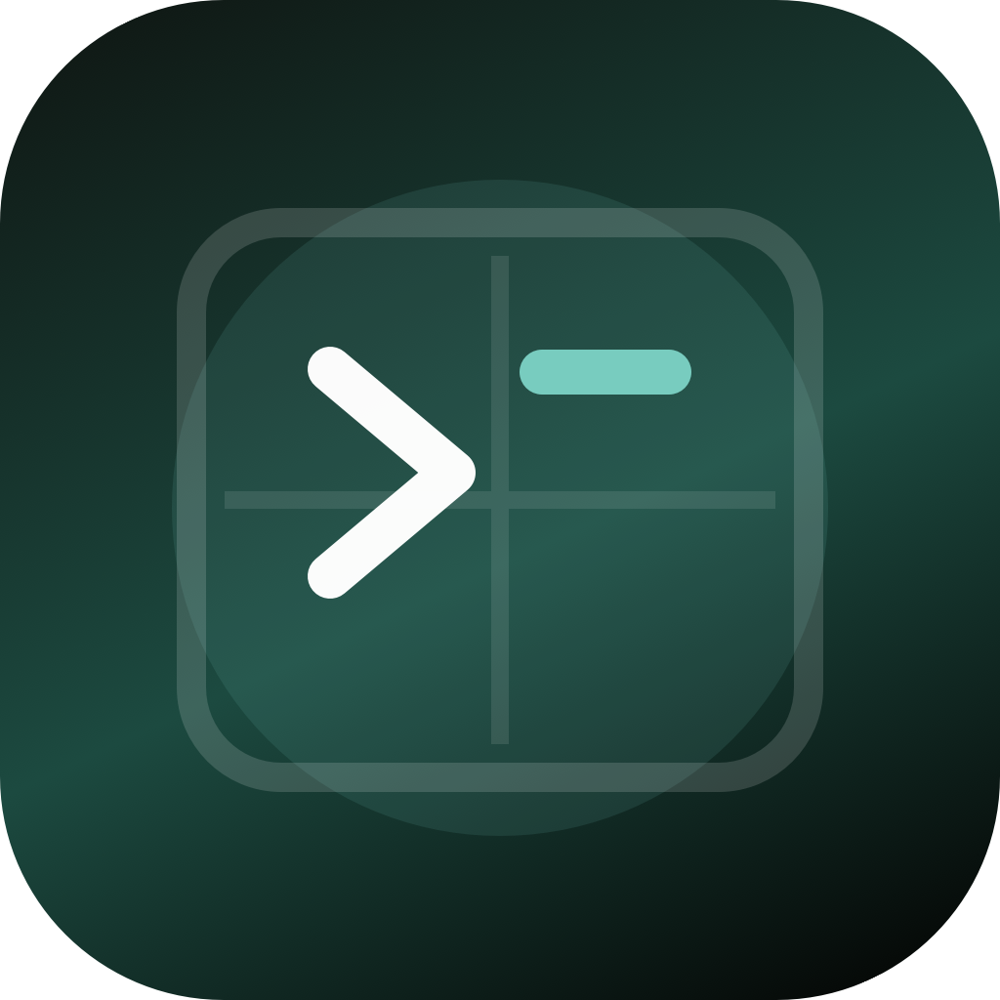
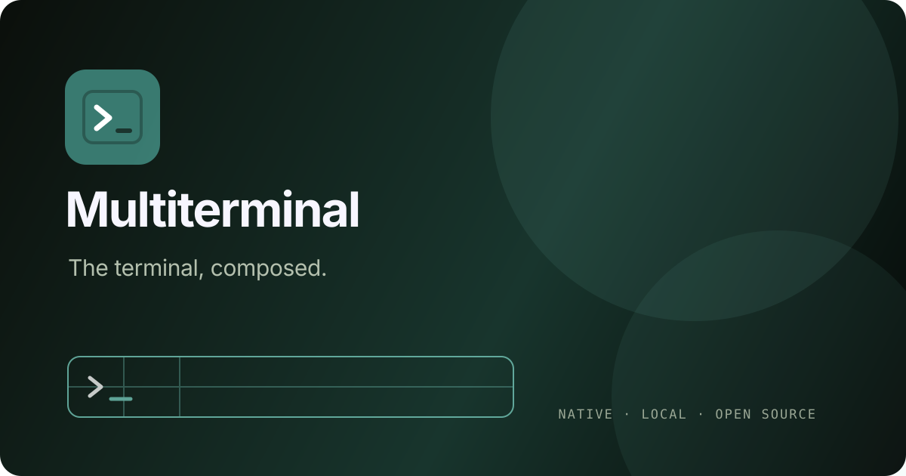

<div align="center">
  
  <h1>Multiterminal</h1>
  <p><strong>The terminal, composed.</strong><br />A native macOS workspace for the shells you already use.</p>

  <p>
    <a href="https://multiterminal.vercel.app">Website</a> ·
    <a href="#get-started">Get started</a> ·
    <a href="https://github.com/arjunkshah12345-hash/multiterminal/issues">Issues</a> ·
    <a href="CONTRIBUTING.md">Contribute</a>
  </p>

  <p>
    <a href="https://github.com/arjunkshah12345-hash/multiterminal/actions/workflows/ci.yml"></a>
    <a href="https://github.com/arjunkshah12345-hash/multiterminal/blob/main/LICENSE"></a>
    <a href="https://github.com/arjunkshah12345-hash/multiterminal"></a>
    
  </p>
</div>

<p align="center">
  
</p>

<p align="center"><sub>One window for the server, the logs, the tests, and the work around them.</sub></p>

Multiterminal turns terminal sprawl into a workspace. Open a folder as a project, let panes
arrange themselves, and keep using your real shell — aliases, history, environment, PTY and
all. It is native Swift + AppKit, local-first, and deliberately boring about your data.

## The short version

<table>
  <tr>
    <td width="33%"><strong>Real shells</strong><br /><sub>Every pane is a genuine PTY running your login shell.</sub></td>
    <td width="33%"><strong>Projects</strong><br /><sub>Folders become durable workspaces with their own sessions.</sub></td>
    <td width="33%"><strong>One calm surface</strong><br /><sub>Panes recompose live instead of becoming window soup.</sub></td>
  </tr>
  <tr>
    <td><strong>Drop to type</strong><br /><sub>Finder files arrive as safe, shell-quoted paths.</sub></td>
    <td><strong>Know when it is done</strong><br /><sub>Native alerts surface background command completion.</sub></td>
    <td><strong>Jump, don’t hunt</strong><br /><sub><kbd>⌘⇧P</kbd> opens a floating navigator across projects.</sub></td>
  </tr>
  <tr>
    <td><strong>Rename any pane</strong><br /><sub>Double-click a header or right-click → Rename… to override the shell title.</sub></td>
    <td><strong>Live themes</strong><br /><sub>Forest, Ink, Slate, Sand, or Light — pick a palette in <kbd>⌘,</kbd> settings.</sub></td>
    <td><strong>Generous scrollback</strong><br /><sub>10,000 lines per pane, so logs stay around without effort.</sub></td>
  </tr>
</table>

## Why it feels better

### Panes arrange themselves

One, two, three, four, six, or nine terminals settle into a readable grid. Add a pane and
the surface recomposes; drag a divider when you want to give one session more room.

<p align="center">
  
</p>

### Projects keep the context attached

Open `~/code/api` once and it becomes a project. New sessions start there. Switch projects
from the sidebar without killing the shells you left running in the other one. Quit and
come back later: names, folders, and pane counts are restored.

### Small details do the heavy lifting

| Moment | What happens |
| --- | --- |
| You drag a file from Finder | The path is inserted at the prompt with shell-safe quoting. Nothing runs automatically. |
| A test finishes in another pane | macOS can notify you, while the pane stays quiet if you are already looking at it. |
| You need a session in another project | Press <kbd>⌘⇧P</kbd>, click its row, and focus jumps there. |
| A pane is in the wrong place | Right-click its header to move it left, right, or into another project. |
| You switch appearance or font size | Settings apply live across the workspace. |

## Get started

Requirements: macOS 12 or later, Xcode Command Line Tools, and Swift 5.9+.

### Run from source

```sh
git clone https://github.com/arjunkshah12345-hash/multiterminal.git
cd multiterminal
swift run
```

### Build a double-clickable app

```sh
sh tools/build_app.sh release
open Multiterminal.app
```

The first build fetches [SwiftTerm](https://github.com/migueldeicaza/SwiftTerm). The project
currently distributes source builds rather than a pre-signed download, so you can inspect
exactly what runs on your Mac.

<table>
  <tr>
    <td width="112"></td>
    <td><strong>Prefer the Makefile?</strong><br /><code>make app</code> assembles a debug app bundle, <code>make verify</code> runs the test/build/layout contract, and <code>make icon</code> regenerates the icon set.</td>
  </tr>
</table>

## Keyboard map

| Shortcut or gesture | Action |
| --- | --- |
| <kbd>⌘T</kbd> | New terminal in the current project |
| <kbd>⌘N</kbd> | New project |
| <kbd>⌘O</kbd> | Open a folder as a project |
| <kbd>⌘⇧P</kbd> | Toggle Session Quick View |
| <kbd>⌘,</kbd> | Open settings |
| <kbd>⌘W</kbd> | Close the focused terminal |
| Right-click pane header | Move or organize a pane |
| Drag a divider | Resize neighboring panes |
| Drag terminal text | Highlight and select text |
| <kbd>⌥</kbd>-drag terminal text | Forward mouse input to apps such as tmux or vim |
| Drag files into a pane | Insert shell-quoted paths |

### Notifications, without noise

On first launch, macOS asks for notification permission. Multiterminal installs a tiny
per-session hook for Zsh or Bash without editing your dotfiles. A command completion can
notify you when its pane is not focused or the app is in the background; the same-pane case
stays quiet. Closing a pane yourself does not create an exit alert.

### tmux

tmux works as a normal program inside every pane. Multiterminal gives the PTY a standard
`xterm-256color` environment, forwards resize events, and keeps the shell's alternate-screen
and control-sequence behavior intact. If the app was launched from an existing tmux pane,
it clears inherited client variables so a new `tmux` command starts cleanly; use
`tmux attach` when you intentionally want an existing session.

## Build apps with Multiterminal via MCP

Multiterminal starts a local [Model Context Protocol](https://modelcontextprotocol.io/)
server alongside the app. It exposes the live workspace over Streamable HTTP, so your own
tools, scripts, agents, and companion apps can inspect projects and sessions or edit them
without maintaining a second state layer.

The server is loopback-only (`127.0.0.1`), uses a generated bearer token, and writes a
client-ready configuration to:

```text
~/Library/Application Support/Multiterminal/mcp.json
```

You can also use **Multiterminal → Copy MCP Configuration** to copy the `mcpServers` block
to an MCP client. The endpoint exposes project/session resources plus tools for reading a
complete workspace snapshot, listing output, creating and editing projects, choosing a
shell, creating/moving/closing/focusing terminals, and sending input to a live PTY.
`send_input` is intentionally explicit: it can execute shell commands, and destructive
mutations require `confirm: true`.

See [`docs/MCP.md`](docs/MCP.md) for the tool contract, a raw JSON-RPC example, and notes
for building an app against the endpoint.

## Under the hood

Pure Swift + AppKit. No storyboard, XIB, Electron shell, account, cloud session layer, or
telemetry.

| Area | Implementation |
| --- | --- |
| Terminal engine | [SwiftTerm](https://github.com/migueldeicaza/SwiftTerm) `LocalProcessTerminalView` |
| Shell lifecycle | `Store.swift` owns projects, sessions, persistence, and PTY wiring |
| Layout | `LayoutMath.swift` keeps the grid contract pure and testable |
| Pane surface | `TerminalGrid.swift` handles chrome, file drops, dividers, and resizing |
| Navigation | `SessionQuickView.swift` jumps across every project |
| Completion alerts | `CommandNotifications.swift` handles shell hooks and native notifications |
| Preferences | `Settings.swift` handles appearance and terminal font size |

Each `TerminalSession` owns its terminal view and stays alive when its project is not visible.
Store refreshes are focus-safe, so a background update does not steal the pane where you are
typing.

## Repository map

```text
Sources/multiterminal/   Native macOS app
Tests/                   Layout and behavior contracts
tools/                   App bundle, icon, and verification scripts
website/                 Product site and share assets
branding/                Mark, palette, and visual identity notes
.github/                 CI, issue forms, contribution workflow
```

## Development

```sh
make verify       # test target, layout contract, release build, diff check
make run          # run from source
make app          # assemble Multiterminal.app
make icon         # regenerate AppIcon.icns and previews
```

CI runs on macOS 14 and macOS 15. It verifies test discovery, builds a release app bundle,
checks its signature, and uploads an app artifact for each runner.

## Local-first by design

- Project metadata lives in `UserDefaults`.
- Shells and commands run on your machine.
- Dropped paths are inserted, not executed.
- The optional MCP bridge is local-only and authenticated; it does not expose a remote
  command service.
- No account, cloud sync, or telemetry.

See [`SECURITY.md`](SECURITY.md) for private vulnerability reporting.

## Contributing

Small, focused pull requests are welcome. Read [`CONTRIBUTING.md`](CONTRIBUTING.md), use the
issue templates, include macOS details for behavior changes, and run `make verify` before
opening a PR.

## License

MIT — see [`LICENSE`](LICENSE).

<div align="center">
  <br />
  
  <br /><br />
  <sub>Made for people who live in the shell.</sub>
</div>
